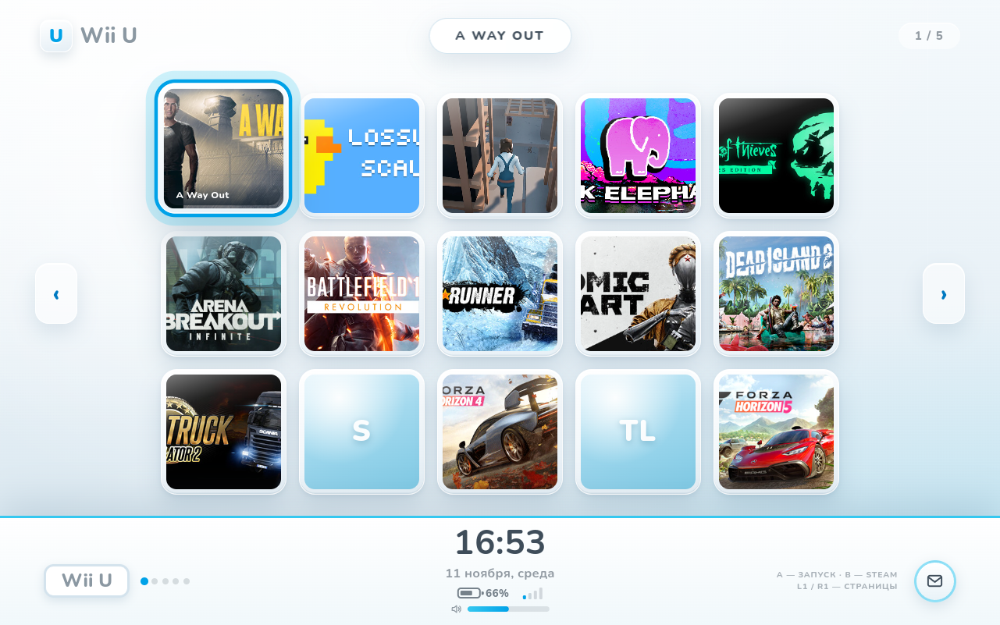
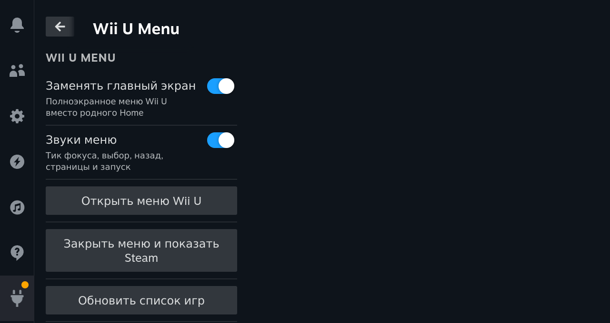
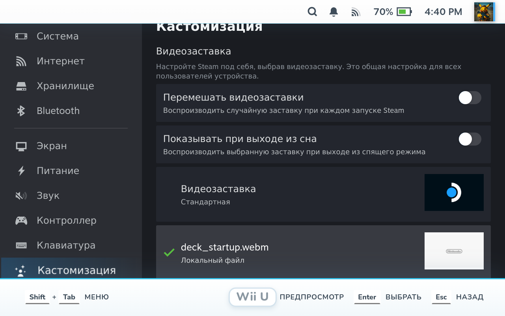

# Wii U Menu for Steam Deck

A fan-made, full-screen Wii U style home menu for Steam Deck, built as a **Decky Loader plugin**, plus a matching **CSS Loader theme** and a **custom startup movie**.



## Features

- Full-screen 5×3 channel grid — 15 games per page, recently played first.
- Launch a game with **A** or a click/tap.
- Page through with **L1/R1**, the side arrows, or PageUp/PageDown.
- Live clock and date in the footer.
- Battery percentage, charging state, and Wi-Fi signal bars under the date.
- Volume bar that follows the system volume.
- Custom synthesized menu sounds: tile focus, select, back, page, open, and launch.
- Direct **Desktop** button in the footer and in the Decky QAM panel.
- The plugin hides Steam's own Home UI while the menu is open, so the stock interface does not show through.
- Optional CSS Loader theme and a Wii U startup movie.

| Decky panel | Boot movie selected |
| --- | --- |
|  |  |

## Install

### 1. Decky plugin (the full menu)

Copy the `WiiUMenuPlugin` folder to:

```
/home/deck/homebrew/plugins/WiiUMenuPlugin
```

The plugins directory is often owned by root. On the Deck:

```bash
sudo cp -r WiiUMenuPlugin /home/deck/homebrew/plugins/
sudo chown -R deck:deck /home/deck/homebrew/plugins/WiiUMenuPlugin
sudo systemctl restart plugin_loader
```

Then open **Quick Access → Decky → Wii U Menu**.

The plugin's backend uses Steam's local CEF debugging endpoint (`127.0.0.1:8080`) to inject the menu into Big Picture. It starts automatically with Decky.

### 2. CSS Loader theme (optional)

Copy `WiiUMenu` to:

```
/home/deck/homebrew/themes/WiiUMenu
```

Then open **CSS Loader → Refresh** and enable **Wii U Menu**. The plugin does not require this theme, but it styles the standard Steam Home that is shown after pressing **B**.

### 3. Startup movie (optional)

Copy:

```
WiiUBootAnimation/deck_startup.webm
```

to:

```
/home/deck/.steam/root/config/uioverrides/movies/deck_startup.webm
```

Then go to **Settings → Customization → Startup Movie** and select **`deck_startup.webm`**.

The movie is WebM/VP8, 1280×800, 30 fps, with Vorbis audio. It is a re-encode of the supplied *Nintendo Wii U - Startup Intro* video; see `NOTICE.md`.

## Controls

| Input | Action |
| --- | --- |
| D-pad / left stick | Move between channels |
| A | Launch the selected game |
| B | Close the menu and show Steam |
| L1 / R1 | Previous / next page |
| Footer monitor icon | Switch to Desktop |
| QAM → Decky → Wii U Menu | Settings, open/close, refresh games, switch to Desktop |

If the menu ever feels stuck, the reliable exits are:

1. **Steam button → Power → Desktop**.
2. **B**, then **Steam → Power → Desktop**.
3. The monitor icon in the bottom-right corner.
4. Hold the power button for ~10 seconds if nothing responds.

## Build the plugin

```bash
cd WiiUMenuPlugin
npm install
npm run build
```

`dist/index.js` is committed so users do not need Node.js.

## How it works

- `main.py` monitors Steam's Game Mode route and CEF targets, injects `menu.js` into the Big Picture page, and connects to Steam's audio/battery/Wi-Fi/volume data.
- `menu.js` is plain JavaScript: a 5×3 grid, controller input, live clock, status indicators, paging, and a small Web Audio synth.
- `theme` and `boot` are independent extras. The plugin does not need CSS Loader.

## Notes

- SteamOS updates occasionally rename Steam UI internals. If the menu stops appearing, update Decky/CSS Loader and restart the Deck.
- Startup movies on SteamOS can sometimes be covered by the Steam logo during cold boot; this is a known SteamOS issue. The provided file is re-encoded in a format that usually works.
- The plugin reads battery from `/sys/class/power_supply`, Wi-Fi from `/proc/net/wireless`, and volume from Steam's audio API. No extra permissions are required.
- All menu sounds are original synthesized effects; no Nintendo audio is sampled.

## Русский

- **Плагин:** скопируйте `WiiUMenuPlugin` в `/home/deck/homebrew/plugins/`, перезапустите Decky.
- **Тема:** скопируйте `WiiUMenu` в `/home/deck/homebrew/themes/`, нажмите Refresh в CSS Loader.
- **Заставка:** `WiiUBootAnimation/deck_startup.webm` → `~/.steam/root/config/uioverrides/movies/`, затем Настройки → Кастомизация → Видеозаставка.
- Выход в рабочий стол: кнопка Steam → Питание → Рабочий стол, либо иконка монитора в меню.

## Credits

- Decky Loader and CSS Loader by the SteamDeckHomebrew / DeckThemes communities.
- Nunito font, SIL Open Font License 1.1.
- Game artwork in screenshots belongs to the respective publishers.
- **Wii U** is a trademark of Nintendo. This is an unofficial fan project, not affiliated with or endorsed by Nintendo or Valve.

## License

The code is MIT licensed; see `LICENSE`. Nintendo trademarks, the startup movie, and game artwork are **not** covered by that license — see `NOTICE.md`.
